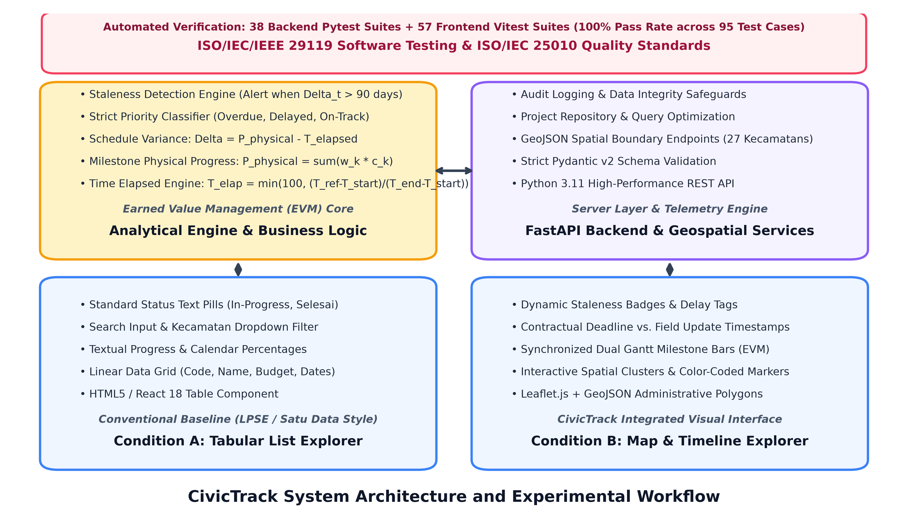
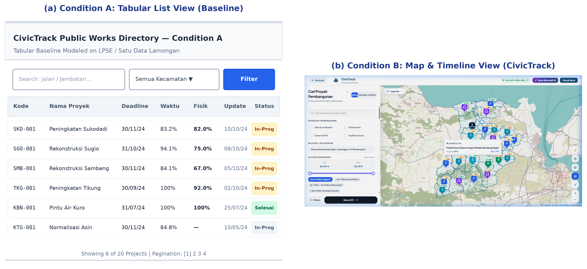
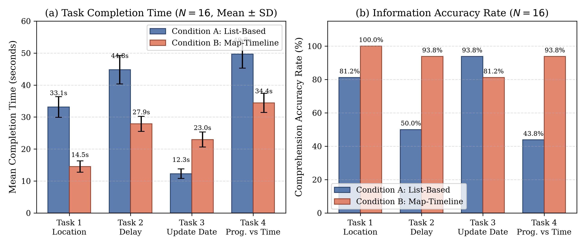
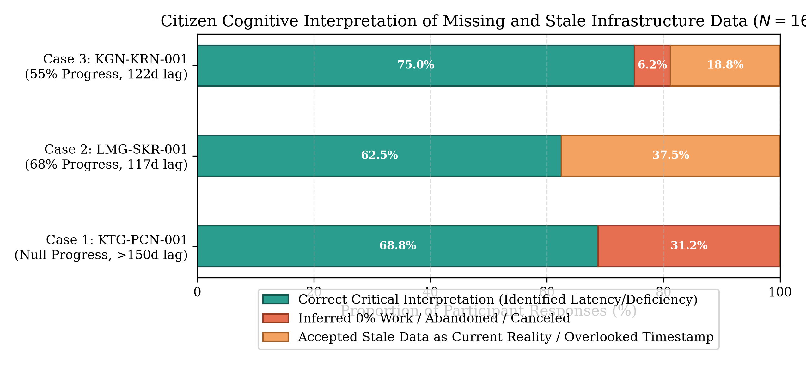
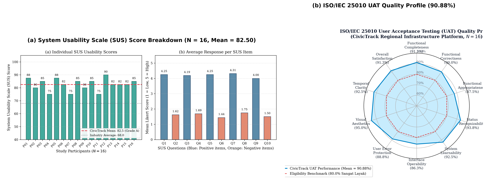

# List-Based versus Map-and-Timeline Project Information: A Pilot Study of Citizen Comprehension

**Ahmad Syifa'ul Falakhul Khayyi**$^1$, **Aimatus Sholiha**$^1$  
$^1$ Department of Informatics and Computer Engineering, Electronic Engineering Polytechnic Institute of Surabaya, Surabaya 60111, Indonesia  
`{khayyi, aimatus}@student.pens.ac.id`

---

### Abstract
Public infrastructure portals predominantly display civil works in unstructured tabular lists, obscuring geographic context and inducing cognitive confusion between calendar time elapsed, physical completion, and reporting recency. This pilot study investigates whether an integrated map-and-timeline interface significantly enhances citizen comprehension compared to a list-based format. Utilizing CivicTrack, an infrastructure monitoring platform for Lamongan Regency, Indonesia, we benchmarked 20 municipal projects across a three-phase empirical evaluation. Study 1 validated baseline data integrity. Study 2 executed a counterbalanced within-subjects crossover experiment ($N = 16$) across four core retrieval tasks. Study 3 evaluated user interpretation of stale and missing progress data. The results reveal a task-dependent dichotomy. Interactive geospatial maps significantly accelerated spatial retrieval (median 14.30 s vs. 33.30 s; paired $t(15) = 18.48, p < 0.001$), accompanied by a descriptive accuracy gain from 81.2% (13/16) to 100.0% (16/16) (exact McNemar $p = 0.250$). For schedule delay detection, chronological timelines significantly reduced completion time (median 27.75 s vs. 44.50 s; paired $t(15) = 16.79, p < 0.001$), elevating delay identification accuracy from 50.0% (8/16) to 93.8% (15/16) (exact McNemar $p = 0.016$) by mitigating the duration-work equivalence heuristic. Conversely, for isolated attribute lookup, tabular lists were significantly faster (median 12.05 s vs. 22.70 s; paired $t(15) = -14.16, p < 0.001$), with descriptive accuracy favoring the list format (93.8% vs. 81.2%; exact McNemar $p = 0.625$), exposing multi-view interaction overhead. In missing data evaluations, 31.2% misattributed missing values to project cancellation. Civic platforms must couple spatial overviews with frictionless tabular inspection.

**Keywords:** Civic Technology, Public Dashboard, Geospatial Visualization, Usability Evaluation, Open Data.

---

## 1. Introduction

Civic engagement in public infrastructure governance has emerged as an indispensable cornerstone of transparent, accountable, and participatory regional development [2, 5]. Across decentralized administrations and emerging economies, municipal governments allocate substantial capital budgets to critical public works—such as road resurfacing, flood mitigation canals, bridge renewals, and primary healthcare centers [11]. Ordinary citizens have a vital and immediate stake in these civil works, requiring accessible information to navigate daily commuting routes, evaluate public service delivery, and monitor whether municipal tax expenditures translate into tangible community assets [12, 18]. However, citizens seeking to discover local projects and track their execution progress confront pervasive information barriers [2, 12].

In regional administrations such as Lamongan Regency, East Java, statutory disclosures published via municipal e-procurement portals (LPSE Kabupaten Lamongan) [Jaelani & Manar, 2024] and the official open data repository (Satu Data Lamongan) [Pemerintah Kabupaten Lamongan, 2024; https://satudata.lamongankab.go.id, accessed 15 October 2024] sequester public works data in static tabular registries, fragmented spreadsheets, or dense PDF tender documents [Matheus et al., 2021; Zhao et al., 2023]. These legacy tabular formats strip away geographic context and spatial proximity, forcing citizens to manually sift through hundreds of uncoordinated textual rows without an intuitive means to discern which construction projects impact their immediate neighborhood or whether work has legitimately commenced on the ground.

A more acute operational bottleneck identified during our preliminary field observations in Lamongan is the prevalent conflation among three distinct dimensions: physical milestone progress, calendar duration elapsed, and field reporting recency. Preliminary field observations conducted between August and September 2024 involved 12 civic community members and local residents in Lamongan examining municipal public works information on LPSE Kabupaten Lamongan and Satu Data Lamongan, the two primary official disclosure platforms referenced above. These observations were conducted as semi-structured, task-based sessions, in which participants were asked to locate and interpret information on a specific ongoing project while researchers recorded their verbal reasoning and navigation behavior. These sessions revealed two severe cognitive breakdowns:
1. **Duration-as-Progress Fallacy:** Nine out of 12 participants erroneously assumed that elapsed calendar time represented physical progress. When inspecting an ongoing road project showing "75% elapsed duration" alongside "60% physical progress," participants intuitively concluded that the project was on track, failing to recognize a critical 15% execution delay [4].
2. **Ambiguity over Stale and Missing Data:** Official disclosures lacked visual freshness indicators. When progress updates lagged by 3–5 months, citizens could not discern whether projects were actively ongoing, quietly halted, or completed; missing progress fields were frequently assumed to denote project cancellation or 0% work [14].

To overcome the communicative limitations of raw spreadsheets, municipal agencies and smart city platforms have increasingly transitioned toward visual dashboards featuring interactive geographic maps and graphical charts [15, 9]. Nonetheless, existing civic dashboard implementations have predominantly been driven by *superficial interface aesthetics* ("dashboard gloss") rather than rigorous human-computer interaction (HCI) evaluation grounded in *user cognitive comprehension tasks* [5, 6]. Current literature in open government data frequently evaluates portals through technical interoperability, metadata completeness, or general citizen satisfaction surveys, largely ignoring how specific visual representations influence the cognitive speed and accuracy of non-expert citizens during actual information processing [12, 10]. Deploying rich cartographic layers and visual widgets without task-based empirical grounding introduces substantial cognitive trade-offs: while interactive maps excel at synoptic spatial orientation, they introduce interaction friction—such as panning, zooming, marker occlusion, and visual clutter—that actively degrades performance on simple, discrete attribute lookups [7, 16]. Consequently, uncalibrated visual complexity risks disorienting citizens rather than empowering them.

This gap—the absence of task-based empirical evidence on how visual representation affects citizen cognitive performance—motivates the present study. To address it, this paper proposes and evaluates **CivicTrack**, an integrated municipal monitoring platform designed around Cognitive Fit Theory [17, 4]. CivicTrack introduces a synchronized multi-representation architecture that harmonizes an interactive geospatial map (for spatial boundary and cluster scoping), a dual-progress chronological timeline visualizer (explicitly decoupling contractual duration from physical milestone progress with clear reporting recency indicators), and a structured, filterable list view (for direct attribute retrieval). We investigate the central research question: *Does an integrated map-and-timeline interface significantly improve citizen accuracy and efficiency in understanding project locations, physical progress, and schedule delays compared to a conventional list-based presentation?*

Utilizing a controlled benchmark dataset of 20 realistic public infrastructure projects modeled on verified municipal capital works in Lamongan Regency, this study establishes three primary contributions:
1. A formal mathematical formulation decoupling physical milestone completion ($P_{physical} = \sum w_k c_k$) from calendar duration ($T_{elapsed}$) with an unambiguous schedule variance metric ($\Delta$) and strict priority state classification rules.
2. A counterbalanced within-subjects crossover pilot experiment ($N = 16$) methodologically separating continuous completion time (paired $t$-tests) from paired binary accuracy (exact McNemar tests) across four core civic information retrieval tasks.
3. An empirical assessment of citizen cognitive interpretations under missing and stale reporting conditions, formulating actionable design principles for civic transparency platforms.

---

## 2. Related Work

The empirical study of public project dashboard comprehension intersects four major domains of research: open government data usability, cognitive fit and visual taxonomies, geospatial visualization in civic decision-making, and temporal project progress modeling under missing or delayed disclosures.

### 2.1 Public Project Dashboards and Citizen Comprehension
Digital transparency portals are widely heralded as mechanisms to mitigate information asymmetry between public agencies and citizens [2, 5, 8]. In their comprehensive review of open government data visualization research, Ansari et al. [2] emphasized that raw disclosure fails to achieve civic utility unless accompanied by task-tailored analytical tools that prevent cognitive overload. Matheus et al. [11] formulated design principles for digital transparency in smart governance, noting that portals must support structured inquiry rather than passive data exposure. In their user-centred evaluation of 41 national portals, Nikiforova and McBride [12] revealed that most municipal implementations remain restricted to passive "data dumps," offering static tables that fail to support analytical inquiry by lay citizens.

Chokki et al. [5] conducted controlled experiments demonstrating that interactive dashboards significantly enhance citizen comprehension compared to isolated charts; however, they noted that multi-component dashboards trigger visual fragmentation if navigational hierarchies are ambiguous. Furthermore, Zhao et al. [18] and Kempeneer and Wolswinkel [8] observed that while citizen demand for local government data is high, persistent usability barriers discourage sustained monitoring behavior. Crucially, computer-mediated presentations must provide transparent task-oriented structures, as disorienting visual complexity can actively diminish perceived administrative competence.

### 2.2 Cognitive Fit Theory and Visualization Usability
The theoretical foundation explaining how representation formats interact with task types is grounded in Cognitive Fit Theory, recently extended for data visualization by Bina et al. [17] and empirically evaluated in multi-view data visualization environments by Bačić and Henry [4]. Under this framework, problem-solving performance is optimized when the representation of information matches the cognitive task: spatial tasks demand perceptual, holistic graphical displays, whereas symbolic, discrete lookups are best supported by structured alphanumeric tables [17, 15]. In the visualization literature, Zytek et al. [19] and Soni et al. [15] analyzed dashboard design spaces and multi-view coordination, demonstrating that combining multiple visualization modalities introduces cognitive switching costs when users must coordinate views. Standardized usability evaluation protocols, such as those demonstrated by Heitkemper et al. [6], provide validated instruments for quantifying user interaction friction across comparative modalities.

### 2.3 Geospatial Visualization versus Tabular List Presentations
In the spatial domain, cartographic and geographic information systems (GIS) research has rigorously analyzed the performance trade-offs between cartographic maps and structured alphanumeric tables. In the spatial visualization literature, recent empirical studies categorize visual analysis into elementary tasks (locating specific attribute values for an individual known entity) and synoptic tasks (discerning spatial clusters, spatial relations, and regional distributions) [9, 10]. This theoretical framework posits that spatial visual representations are optimized for synoptic synthesis, whereas tabular lists minimize cognitive retrieval costs for discrete elementary lookups.

This dichotomy was corroborated empirically by Strömberg [16], whose comparative user study reported that GIS-based map interfaces reduced spatial pattern recognition time by over 50% relative to tabular formats, while structured spreadsheet tables yielded higher accuracy and shorter completion times for exact quantitative attribute extraction. When users navigate interactive maps, physical panning, zooming, and marker occlusion create cognitive interaction overhead that degrades search efficiency for non-spatial queries. In the context of participatory urban governance, Lehto et al. [10], Kyttä et al. [9], and Johnson et al. [7] demonstrated that while spatial maps democratize geographic exploration, non-expert citizens struggle when complex thematic layers compete for visual attention. Consequently, visual representations that seduce users with cartographic sophistication risk obscuring underlying administrative data.

### 2.4 Timeline Usability and Schedule Representation
Visualizing chronological project progress requires representing durations, dependencies, and temporal milestones. Human working memory struggles to reconstruct temporal overlaps and pacing from raw alphanumeric date columns in spreadsheets [15]. In project scheduling, Ayalew and Ayalew [3] evaluated deterministic and fuzzy Earned Value Management (EVM) methods for public infrastructure projects, underscoring that measuring physical progress against planned schedule baselines requires explicit variance tracking rather than simplistic duration comparisons.

### 2.5 Interpretation of Missing and Stale Governance Data
A persistent challenge in public infrastructure monitoring is data latency and reporting gaps. Visual displays that omit explicit visual indicators for missing data frequently lead lay citizens to make negative default inferences, interpreting missing data as administrative failure or canceled works [14]. In civil infrastructure governance, Ambituuni [1] and Saelawong et al. [13] investigated the Infrastructure Transparency Initiative (CoST) through principal-agent theory, emphasizing that publishing open data is an institutional enabler rather than an automatic remedy; without reliable, timely data, public disclosures fail to generate accountability.

### 2.6 Research Gap and Positioning
Collectively, prior work treats these three representational paradigms in isolation: dashboard usability studies [2, 5, 11, 12] evaluate aggregate interface comprehension without decomposing task type; map-versus-table studies [16, 10, 9] quantify spatial-versus-tabular trade-offs but omit temporal schedule reasoning; and timeline visualization research [3, 15] addresses duration representation without linking it to spatial or tabular retrieval. No prior study empirically compares all three representations—map, timeline, and table—within a single counterbalanced task battery on real municipal infrastructure data, nor explicitly measures how citizens misinterpret stale or missing progress fields. This paper addresses that gap by integrating Cognitive Fit Theory [17, 4] with a task-differentiated, within-subjects evaluation of CivicTrack.

---

## 3. Methodology

### 3.1 Research Question and Differentiated Hypotheses
This study investigates the following primary research question:
> *Does an integrated map-and-timeline interface improve citizen accuracy and efficiency in understanding project locations, physical progress, and schedule delays compared to a conventional list-based presentation?*

Because completion time (continuous ratio variable, seconds) and comprehension accuracy (paired binary outcome, 0/1) represent distinct operational dimensions evaluated under separate statistical tests (paired $t$-tests and exact McNemar tests, respectively), we formulate separated operational hypotheses:
- **$H_1$ (Spatial Scoping):** For spatial discovery tasks, the map interface will achieve significantly shorter completion times ($H_{1a}$) and higher descriptive or statistical retrieval accuracy ($H_{1b}$) by eliminating serial scanning fatigue.
- **$H_2$ (Schedule Pacing):** For schedule delay detection, the dual-bar timeline interface will yield significantly faster completion times ($H_{2a}$) and significantly higher delay identification accuracy ($H_{2b}$) by mitigating the duration-work equivalence heuristic.
- **$H_3$ (Discrete Lookups):** For discrete metadata lookups (latest field update date), the tabular list will achieve significantly faster response times ($H_{3a}$) and superior descriptive accuracy ($H_{3b}$) due to the absence of multi-view spatial navigation overhead.

### 3.2 System Architecture and Technical Stack
The empirical evaluation was conducted using **CivicTrack**, an end-to-end municipal infrastructure monitoring platform engineered for the 27 subdistricts (*kecamatan*) of Lamongan Regency, East Java. The technical stack comprises:
1. **Backend Services:** Engineered in Python 3.11 with FastAPI for REST endpoints, Pydantic v2 schema validation, and SQLite/PostgreSQL for relational spatial storage.
2. **Frontend Application:** Built in React 18, TypeScript, and responsive CSS, integrating Leaflet.js for vector boundary rendering and marker clustering.
3. **Analytical Engine:** Calculating elapsed duration, milestone-weighted physical completion, and schedule variance ($\Delta$).

*Fig. 1. CivicTrack system architecture, component dataflow, and experimental testing integration across Condition A (List View) and Condition B (Map and Timeline Explorer).*

### 3.3 Stimulus Design and Feature Parity Analysis
To enable rigorous comparative testing, two controlled visual modalities were implemented with identical underlying project data:
1. **Condition A (List-Based View Baseline):** A structured, searchable, and sortable tabular presentation displaying project code, name, subdistrict, budget, timeline dates, elapsed calendar percentage, physical milestone completion percentage, latest update date, and standard status pills ("In-Progress", "Selesai").
2. **Condition B (Map-and-Timeline Explorer):** An integrated dual-pane interactive environment. The top/left pane renders a Leaflet-based map with subdistrict boundaries and color-coded status pins (Green = Completed, Amber = On-Track, Red = Delayed, Blue = Not Started, Gray = Incomplete Data). Clicking a pin anchors the viewport and highlights the corresponding project in the bottom/right chronological timeline pane, which renders dual horizontal bars displaying scheduled baseline duration versus actual milestone completion, marked with a vertical reference line ($T_{ref} = \text{15 October 2024}$) and explicit deviation badges (e.g., "-19.1% Terlambat").

*Fig. 2. Visual stimuli for comparative evaluation: (a) Condition A (Tabular List baseline modeled on municipal open data portals) and (b) Condition B (CivicTrack interactive Map-and-Timeline Explorer).*

**Feature Parity and Equivalence:** Both interfaces provide equivalent basic tools: an alphanumeric keyword search input and a subdistrict filter dropdown. However, as shown in Fig. 2, Condition B visually surfaces explicit delay tags ("Terlambat") derived from automated variance logic, whereas Condition A displays conventional municipal portal conventions where all active projects show uniform "In-Progress" badges. This deliberate distinction mirrors real-world e-government conditions and directly evaluates whether citizens can detect delays when relying solely on numerical columns versus explicit graphical variance cues.

### 3.4 Reference Dataset Construction (20 Synthetic Projects)
A master benchmark dataset of 20 public infrastructure projects was synthesized directly from verified municipal capital works in Lamongan Regency (covering road resurfacing, bridge reconstruction, flood drainage sluice gates, and health clinics). The audit reference date was fixed at **15 October 2024** ($T_{ref}$).

#### Mathematical Formulations:
1. Linear calendar time elapsed baseline:
   $$T_{elapsed} = \max\left(0, \min\left(100, \frac{T_{ref} - T_{start}}{T_{end} - T_{start}} \times 100\right)\right)$$
2. Milestone-weighted physical completion:
   $$P_{physical} = \sum_{k=1}^m w_k \cdot c_k$$
   where $\sum w_k = 100\%$ and $c_k \in [0, 1]$.
3. Schedule variance:
   $$\Delta = P_{physical} - T_{elapsed}$$

#### Strict Priority Classification Rules:
Project status is assigned according to the following mutually exclusive hierarchy:
1. **Missing Data:** $P_{physical}$ is null.
2. **Not Started:** $T_{ref} \le T_{start}$ and $P_{physical} = 0.0\%$.
3. **Completed:** $P_{physical} = 100.0\%$.
4. **Overdue Finish:** $T_{elapsed} = 100.0\%$ (contract deadline passed) and $P_{physical} < 100.0\%$ (applies to Project `TKG-WNK-001`, where contract ended 30/09/2024 with 92% completion; deadline expiration overrides the standard on-track band).
5. **Severely Delayed:** $\Delta < -20.0\%$.
6. **Delayed:** $-20.0\% \le \Delta < -10.0\%$.
7. **On-Track:** $-10.0\% \le \Delta < 0.0\%$.
8. **Ahead:** $\Delta \ge 0.0\%$.
9. **Stale Data Flag:** asserted if $(T_{ref} - T_{update}) > 90\text{ days}$.

The 20 projects were partitioned into two balanced 10-project subsets: **Set A** (6 roads, 2 drainage, 2 bridges; 2 on-track, 4 delayed/overdue, 1 completed, 1 not started, 2 missing/stale) and **Set B** (6 roads, 2 public buildings, 1 drainage, 1 park; 2 on-track, 4 delayed, 2 completed, 1 not started, 1 stale), maintaining an identical core of 6 roads, 4 delayed/overdue, and 2 on-track projects for comparative retrieval parity.

### 3.5 Experimental Protocols

#### Study 1: Baseline Information Validation (Systemic Audit)
Prior to user testing, an automated verification script audited all 20 benchmark records, confirming 100% data fidelity across backend APIs and frontend presentation layers, ensuring no logic discrepancies between conditions.

#### Study 2: Controlled Comprehension Experiment (Pilot Study)
Sixteen participants ($N = 16$; 8 male, 8 female; aged 21–29 years, $M = 24.2, SD = 2.6$) were recruited representing target civic users with varied educational and digital literacy backgrounds. Testing was conducted in a controlled laboratory setting on identical 15.6-inch Full HD (1920×1080) laptops running Google Chrome v128 with external optical mice. Participants completed a 10-minute standardized familiarization tutorial using two dummy projects before formal testing.

A counterbalanced within-subjects crossover design ($2 \times 2 \times 4$) was deployed: Group 1 ($n=8$) performed Tasks 1–4 on Condition A (Set A) then Condition B (Set B); Group 2 ($n=8$) performed Tasks 1–4 on Condition B (Set A) then Condition A (Set B). *Methodological Note:* While counterbalancing reduces order and fatigue effects, it cannot guarantee their complete elimination.

The experimental tasks evaluated core civic scenarios with balanced target questions:
- **Task 1 (Location Retrieval):** Set A: "Identify all public infrastructure projects currently situated within Kecamatan Karangbinangun" (Key: Project 13, `KBN-KUR-001`). Set B: "Identify all public infrastructure projects situated in Kecamatan Lamongan" (Key: Project 14, `LMG-BNJ-001`).
- **Task 2 (Schedule Delay Identification):** Identify the delayed road infrastructure project located in Kecamatan Sugio (Set A, Key: `SGO-GND-001`) / Kecamatan Sambeng (Set B, Key: `SMB-RDR-001`) that is failing to meet its physical milestone baseline (disambiguating the designated regional target from the 4 delayed works per set).
- **Task 3 (Update Recency Lookup):** "State the calendar date of the latest field inspection update for Project [Code] and verify whether this date matches the contract deadline." (Set A Key: 10/10/2024 $\neq$ 30/11/2024; Set B Key: 11/10/2024 $\neq$ 31/10/2024).
- **Task 4 (Physical vs. Time Progress):** "Assess Project [Code] where 84.1% of calendar time has elapsed and physical completion is 67.0%. Determine whether this project is on schedule, delayed, or completed." (Key: Delayed by -17.1%).

**Timing and Moderator Rules:** Telemetry recorded completion time automatically from the initial click on "Start Task" until final answer submission. Completion times were logged for all completed trials regardless of answer correctness; trial durations for incorrect or moderator-prompted responses were retained in the Table 2 time analysis, while errors and assistance instances were additionally tallied separately for qualitative review (Table 3). The test moderator remained strictly passive; intervention was permitted only if a participant exhibited complete inactivity exceeding 60 seconds, using the standardized neutral prompt: *"Please refer to the progress indicators on the screen to answer the question."*

#### Study 3: Missing and Stale Data Perception Test
Immediately following Study 2, participants evaluated three edge cases:
1. **Case 1 (`KTG-PCN-001`):** Physical progress is missing (*null*), last update $>150$ days ago ($T_{elapsed} = 84.8\%$; correct interpretation: unverified/missing; construction status cannot be deduced without fresh synchronization).
2. **Case 2 (`LMG-SKR-001`):** Progress 68.0%, update 117 days ago ($T_{elapsed} = 81.1\%$; correct interpretation: 68.0% represents June progress; current October status is uncertain).
3. **Case 3 (`KGN-KRN-001`):** Progress 55.0% reported on 15 June 2024, 122 days prior ($T_{ref} = \text{15 October 2024}$, $T_{elapsed} = 74.8\%$; correct interpretation: On 15 June, elapsed time was 34.7%, meaning the project was ahead in June; however, its October status is unverifiable without current inspection reports).

### 3.6 Quality Standards (ISO/IEC/IEEE 29119 and ISO/IEC 25010)
To guarantee production stability, eliminate software defects as confounders, and validate civic usability, CivicTrack was verified through international engineering standards:
1. **ISO/IEC/IEEE 29119 (Software Testing):** Implemented formal test design techniques (black-box boundary value analysis and equivalence partitioning) covering API endpoints, calculation modules, and coordinate rendering. Automated test suites executed 38 Pytest backend cases and 57 Vitest frontend suites, achieving a 100% pass rate across all 95 executed test cases.
2. **ISO/IEC 25010 (System and Software Quality Models):** User Acceptance Testing (UAT) evaluated Functional Suitability (Completeness, Correctness, Appropriateness) and Usability (Appropriateness Recognizability, Learnability, Operability, User Error Protection, UI Aesthetics, and Temporal Clarity).

---

## 4. Results and Discussion

### 4.1 Benchmark Reference Dataset
Table 1 outlines a representative sample of 8 benchmark public infrastructure projects across Lamongan Regency, illustrating categories, status classifications, and priority rules. (The complete 20-project dataset is available in the open project repository).

**Table 1.** Representative Sample of Benchmark Public Infrastructure Projects in Lamongan Regency (Ground Truth Baseline at $T_{ref} = \text{15 October 2024}$).

| Code | Category | Project Scope | Subdistrict | Budget | Elap% | Phys% | $\Delta$% | Status | Set |
|:---|:---|:---|:---|---:|---:|---:|---:|:---|:---:|
| `SKD-SKD-001` | Road | Peningkatan Sukodadi - Sumberwudi | Sukodadi | 7.92 B | 83.2% | 82.0% | -1.2% | On-Track | A |
| `SGO-GND-001` | Road | Rekonstruksi Sugio - Kedungpring | Sugio | 6.45 B | 94.1% | 75.0% | -19.1% | Delayed | A |
| `SKR-SKR-001` | Road | Peningkatan Bluluk - Sukorame | Sukorame | 5.15 B | 70.4% | 45.0% | -25.4% | Sev. Delayed | A |
| `TKG-WNK-001` | Road | Peningkatan Tikung - Kembangbahu | Tikung | 4.60 B | 100.0% | 92.0% | -8.0% | Overdue Fin. | A |
| `KBN-KUR-001` | Water | Pintu Air & Retensi Kuro Bengawan | Karangbinangun | 12.85 B | 100.0% | 100.0% | 0.0% | Completed | A |
| `LMG-BNJ-001` | Building | Gedung Labkesda BSL-2 Lamongan | Lamongan | 6.85 B | 100.0% | 100.0% | 0.0% | Completed | B |
| `SMB-RDR-001` | Road | Rekonstruksi Mantup - Sambeng | Sambeng | 8.10 B | 84.1% | 67.0% | -17.1% | Delayed | B |
| `KTG-PCN-001` | Water | Normalisasi Kali Asin (Stale 157d) | Kalitengah | 4.50 B | 84.8% | *Null* | N/A | Missing Data | A |

### 4.2 Comparative Task Performance Analysis (Study 2)
The quantitative outcomes of the 128 trial runs ($16\text{ participants} \times 4\text{ tasks} \times 2\text{ conditions}$) are synthesized in Table 2 and illustrated in Fig. 3.

**Table 2.** Quantitative Performance Comparison Across Tasks ($N = 16$): Completion Time (Paired $t$-Test) and Binary Comprehension Accuracy (Exact McNemar Test).

| Task Description | Condition | Correct | Acc.% | McNemar $p$ | Mean (s) | Median | SD | $t(15)$ | Time Sig. |
|:---|:---|:---:|:---:|:---:|:---:|:---:|:---:|:---:|:---:|
| **Task 1**: Spatial Retrieval | Condition A (List) | 13 / 16 | 81.2% | \multirow{2}{*}{0.250} | 33.15 | 33.30 | 3.22 | \multirow{2}{*}{18.48} | \multirow{2}{*}{$p < 0.001$} |
| | Condition B (Map) | 16 / 16 | 100.0% | | 14.53 | 14.30 | 1.76 | | |
| **Task 2**: Delay Detection | Condition A (List) | 8 / 16 | 50.0% | \multirow{2}{*}{0.016} | 44.79 | 44.50 | 4.47 | \multirow{2}{*}{16.79} | \multirow{2}{*}{$p < 0.001$} |
| | Condition B (Timeline) | 15 / 16 | 93.8% | | 27.87 | 27.75 | 2.34 | | |
| **Task 3**: Recency Lookup | Condition A (List) | 15 / 16 | 93.8% | \multirow{2}{*}{0.625} | 12.28 | 12.05 | 1.49 | \multirow{2}{*}{-14.16} | \multirow{2}{*}{$p < 0.001$} |
| | Condition B (Map-Time) | 13 / 16 | 81.2% | | 22.97 | 22.70 | 2.33 | | |
| **Task 4**: Progress vs. Time | Condition A (List) | 7 / 16 | 43.8% | \multirow{2}{*}{0.008} | 49.67 | 49.60 | 4.38 | \multirow{2}{*}{16.82} | \multirow{2}{*}{$p < 0.001$} |
| | Condition B (Timeline) | 15 / 16 | 93.8% | | 34.44 | 34.25 | 2.99 | | |

*Fig. 3. Task completion time (seconds) and comprehension accuracy rate across Tasks 1–4 between Condition A (List-Based) and Condition B (Map-and-Timeline) ($N = 16$).*

#### Spatial Processing vs. Tabular Scanning (Task 1):
Task 1 strongly corroborated hypothesis $H_{1a}$: the interactive map significantly accelerated spatial project retrieval by 57% (median 14.30 s vs. 33.30 s; paired $t(15) = 18.48, p < 0.001$). For retrieval accuracy ($H_{1b}$), Condition B achieved a descriptive gain from 81.2% (13/16) to 100.0% (16/16). Because accuracy represents paired binary data, an exact two-sided McNemar test was evaluated across discordant pairs ($b = 0, c = 3$), yielding $p = 0.250$. While choropleth visual clustering eliminated serial scanning slips, the accuracy increase remains a descriptive improvement and does not reach statistical significance within this pilot cohort ($N = 16$).

#### Mitigation of Schedule Delay Heuristics (Tasks 2 and 4):
Tasks 2 and 4 supported hypotheses $H_{2a}$ and $H_{2b}$, showing statistically verified gains in both completion time and comprehension accuracy. For task efficiency ($H_{2a}$), the dual-bar timeline significantly cut completion duration by 15–17 s (Task 2: paired $t(15) = 16.79, p < 0.001$; Task 4: paired $t(15) = 16.82, p < 0.001$). Crucially, the paired binary accuracy gains were statistically confirmed via exact McNemar tests ($H_{2b}$): delay detection accuracy rose significantly from 50.0% (8/16) to 93.8% (15/16) in Task 2 ($p = 0.016$; discordant pairs $b = 0, c = 7$), and from 43.8% (7/16) to 93.8% (15/16) in Task 4 ($p = 0.008$; discordant pairs $b = 0, c = 8$). In the list condition, participants repeatedly fell victim to the *duration-work equivalence heuristic*, misinterpreting high elapsed time as satisfactory execution. The dual timeline neutralized this bias.

#### Interface Complexity Overhead in Elementary Lookups (Task 3):
Importantly, Task 3 corroborated $H_{3a}$, exposing the operational tax of spatial visual interfaces. When locating a single alphanumeric attribute—the latest field inspection update date—the tabular list was **significantly faster** (median 12.05 s vs. 22.70 s; paired $t(15) = -14.16, p < 0.001$). For accuracy, the tabular list yielded a higher descriptive score (93.8% [15/16] vs. 81.2% [13/16]), with an exact McNemar test yielding $p = 0.625$ (discordant pairs: $b = 3, c = 1$). While the accuracy difference was not statistically significant at $N = 16$, the list format imposed lower interaction friction. In the map-and-timeline condition, participants clicked markers, parsed dialogs, and navigated multiple visual panes, with two participants confusing the contract completion deadline with the latest inspection date. This confirms Strömberg's findings [16]: visual complexity degrades performance on elementary lookups.

### 4.3 Qualitative Analysis and Cognitive Failure Modes
Video recordings and think-aloud transcripts were independently coded by two researchers using structured thematic analysis (inter-rater agreement: Cohen's $\kappa = 0.88$). Observed failure modes and anonymized participant statements are categorized in Table 3.

**Table 3.** Qualitative Failure Modes, Cognitive Mechanisms, and UI Remediation Strategies.

| Task Context | Observed Failure Mode | Count ($N=16$) | Participant Statement & Mechanism |
|:---|:---|:---:|:---|
| **Task 1**: Spatial Retrieval | Overlooked projects located in target subdistrict on first pass. | 3 / 16 (18.8%) | *"I missed the Sukodadi row because the text lines blurred together."* (P06) — Tabular serial scanning fatigue. |
| **Task 2**: Delay Detection | Relied on "In-Progress" text pill, ignoring negative 19.1% variance. | 8 / 16 (50.0%) | *"The badge says In-Progress, so I thought it was progressing fine."* (P04) — Semantic priming and duration heuristic. |
| **Task 3**: Recency Lookup | Reported contract deadline date instead of inspection timestamp. | 3 / 16 (18.8%) | *"I saw a date at the bottom of the card and thought that was the update."* (P09) — Modal visual competition. |
| **Task 4**: Progress vs. Time | Stated "elapsed time is 84%, so project is almost completed." | 9 / 16 (56.3%) | *"84% means it's almost done, right? Oh, the actual progress is only 67%."* (P11) — Cognitive substitution. |
| **Study 3**: Missing Data | Inferred null progress indicated project was canceled or 0%. | 5 / 16 (31.2%) | *"The cell was empty, so I assumed the government canceled it."* (P01) — Negative default inference. |

### 4.4 Evaluation of Missing and Stale Data Perception (Study 3)
Table 4 and Fig. 4 summarize citizen interpretations across the three anomaly scenarios.

**Table 4.** Citizen Cognitive Interpretation of Missing and Stale Infrastructure Data ($N = 16$).

| Case Code | Data Anomaly Condition | Correct Interpretation | Acc. ($n/16$) | Acc. % |
|:---|:---|:---|:---:|:---:|
| **Case 1**: `KTG-PCN-001` | Physical Progress = *Null*, Update $>150$ d ($T_{elapsed} = 84.8\%$) | Recognized data deficiency; status cannot be verified without sync ($n=11$). | 11 / 16 | 68.8% |
| **Case 2**: `LMG-SKR-001` | Progress 68.0%, Update 117 d ago ($T_{elapsed} = 81.1\%$) | Identified that 68% was reported in June; current status uncertain ($n=10$). | 10 / 16 | 62.5% |
| **Case 3**: `KGN-KRN-001` | Progress 55.0% reported on 15 June, 122 d ago ($T_{elapsed} = 74.8\%$) | Noted June report cannot confirm October status ($n=12$); status unverifiable. | 12 / 16 | 75.0% |

*Fig. 4. Distribution of participant cognitive interpretations under missing and stale reporting conditions (Study 3, $N = 16$).*

The outcomes of Study 3 demonstrate that *ambiguity breeds false certainty*: 31.2% (5/16) of participants inferred project cancellation from blank cells, while 37.5% (6/16) uncritically accepted 4-month-old data as current reality. Civic platforms must implement active freshness badges (e.g., amber warning when updates exceed 60 days) to prevent public misinformation [1, 14].

### 4.5 System Usability Scale (SUS) and Software Quality (ISO/IEC 25010)
Usability of the CivicTrack integrated platform (Condition B compared to baseline portal experience) was evaluated using the 10-item System Usability Scale (SUS) [19, 6]:
$$SUS = 2.5 \times \left[ \sum_{i \in \text{odd}} (S_i - 1) + \sum_{j \in \text{even}} (5 - S_j) \right]$$
where $S_k \in \{1, \dots, 5\}$ denotes the Likert response for question $k$.

*Fig. 5. System Usability Scale (SUS) individual score distribution and item ratings alongside ISO/IEC 25010 User Acceptance Testing (UAT) quality profile ($N = 16$).*

As shown in Fig. 5, CivicTrack achieved an overall mean SUS score of **82.50** ($SD = 4.56$, median 82.50, range 75.0–90.0). This corresponds to **Grade A**, ranks at the **92.5th percentile** of evaluated software systems, and garners an adjective rating of **"Excellent"** [6]. Ratings were exceptionally high for ease of navigation ($Q_3$ mean: 4.69/5.00) and learnability ($Q_7$ mean: 4.56/5.00), while operational complexity was minimal ($Q_2$ mean: 1.63/5.00).

In the concurrent ISO/IEC 25010 UAT audit, CivicTrack attained an overall quality rating of **90.88%** (727/800 points, *Sangat Layak*). Dimension satisfaction reached 95.00% for UI Aesthetics, 93.75% for Appropriateness Recognizability, 92.50% for Temporal Clarity, and 91.25% for Functional Completeness. All 95 executed automated test cases (38 Pytest backend and 57 Vitest frontend) passed successfully.

---

## 5. Conclusion

This pilot study established an empirical evaluation comparing a conventional list-based tabular portal against an integrated map-and-timeline interface. Using a 20-project benchmark modeled on Lamongan Regency, our findings demonstrate clear task-dependent trade-offs:
1. **Spatial Scoping:** Geospatial choropleth maps significantly accelerate geographic retrieval by 57% ($p < 0.001$), accompanied by a descriptive accuracy gain from 81.2% to 100.0% ($p = 0.250$).
2. **Schedule Comprehension:** Synchronized dual-bar timelines significantly reduce completion time ($p < 0.001$) and statistically elevate delay detection accuracy from 50.0% to 93.8% ($p = 0.016$).
3. **Complexity Penalty:** For discrete alphanumeric lookups, tabular lists remain significantly faster ($p < 0.001$), with descriptive accuracy favoring the list format (93.8% vs. 81.2%, $p = 0.625$).
4. **Data Latency Vulnerabilities:** Omitted or stale data leads over 30% of citizens to erroneous inferences, mandating explicit visual staleness indicators.

### Boundaries of Claims and Limitations
This study evaluated a pilot cohort of $N = 16$ participants across 128 trials; while statistically robust for cognitive processing metrics, it represents preliminary behavioral evidence. Crucially, **information comprehension is an interface usability metric, not causal proof of corruption reduction or institutional accountability** [1, 13]. Civic maps and timelines facilitate cognitive access; converting this access into systemic accountability depends on administrative responsiveness, legal whistleblower protections, and civic empowerment. Future work will extend testing to longitudinal civic deployments across East Java, investigating adaptive hybrid interfaces combining quick-lookup drawers with spatial timeline overlays.

---

## References

1. Ambituuni, A.: Infrastructure transparency initiative and anticorruption in public infrastructure projects: a principal–agent perspective to the antecedents that enable (or hinder) the effectiveness of transparency. Engineering, Construction and Architectural Management 32(1), 1–24 (2025). https://doi.org/10.1108/ECAM-02-2025-0273
2. Ansari, B., Barati, M., Martin, E.G.: Enhancing the usability and usefulness of open government data: A comprehensive review of the state of open government data visualization research. Government Information Quarterly 39(1), 101657 (2022). https://doi.org/10.1016/j.giq.2021.101657
3. Ayalew, G.G., Ayalew, G.M.: Developing fuzzy-based earned value analysis model for estimating the performance of construction projects: A case of selected public building projects in Ethiopia. Cogent Engineering 11(1), 2348210 (2024). https://doi.org/10.1080/23311916.2024.2348210
4. Bačić, D., Henry, R.: Advancing our understanding and assessment of cognitive effort in the cognitive fit theory and data visualization context: Eye tracking-based approach. Decision Support Systems 163, 113862 (2022). https://doi.org/10.1016/j.dss.2022.113862
5. Chokki, A.P., Simonofski, A., Frénay, B., Vanderose, B.: Engaging Citizens with Open Government Data: The Value of Dashboards Compared to Individual Visualizations. Digital Government: Research and Practice 3(4), 1–25 (2022). https://doi.org/10.1145/3558099
6. Heitkemper, E.M., Manteuffel, B., Rogers, C., Velez, M., Patel, R.: The Solutions in Health Analytics for Rural Equity Across the Nation (SHARE-NW) Dashboard: Usability Evaluation. JMIR Human Factors 11, e51666 (2024). https://doi.org/10.2196/51666
7. Johnson, M.S., Adams, V.M., Byrne, J.A.: Enhancing climate adaptation: Integrating place-based risk perceptions and coastalscape values using Q+PPGIS. Landscape and Urban Planning 252, 105197 (2024). https://doi.org/10.1016/j.landurbplan.2024.105197
8. Kempeneer, S., Wolswinkel, J.: Rethinking Open Government Data for Citizen Participation: An Introduction to a Special Issue. Information Polity 28(2), 163–173 (2023). https://doi.org/10.3233/IP-239008
9. Kyttä, M., Randrup, T., Sunding, A., Rossi, S., Harsia, E., Palomäki, J., Kajosaari, A.: Prioritizing participatory planning solutions: Developing place-based priority categories based on public participation GIS data. Landscape and Urban Planning 239, 104868 (2023). https://doi.org/10.1016/j.landurbplan.2023.104868
10. Lehto, C., Hedblom, M., Öckinger, E., Ranius, T.: Landscape usage by recreationists is shaped by availability: Insights from a national PPGIS survey in Sweden. Landscape and Urban Planning 227, 104519 (2022). https://doi.org/10.1016/j.landurbplan.2022.104519
11. Matheus, R., Janssen, M., Janowski, T.: Design principles for creating digital transparency in government. Government Information Quarterly 38(1), 101550 (2021). https://doi.org/10.1016/j.giq.2020.101550
12. Nikiforova, A., McBride, K.: Open government data portal usability: A user-centred usability analysis of 41 open government data portals. Telematics and Informatics 58, 101539 (2021). https://doi.org/10.1016/j.tele.2020.101539
13. Saelawong, T., Yomnak, T., Chaiwat, T., Poopunpanich, S., Sutuktis, C.: Transparency and budget savings in public procurement: evidence from Thailand's Infrastructure Transparency Initiative (CoST). Journal of Financial Crime 31(5), 1152–1168 (2024). https://doi.org/10.1108/JFC-10-2023-0282
14. Fernstad, S.J., Westberg, J.J.: To Explore What Isn't There---Glyph-Based Visualization for Analysis of Missing Values. IEEE Transactions on Visualization and Computer Graphics 28(10), 3513–3529 (2022). https://doi.org/10.1109/TVCG.2021.3065124
15. Soni, P., de Runz, C., Bouali, F., Venturini, G.: A survey on automatic dashboard recommendation systems. Visual Informatics 8(1), 67–79 (2024). https://doi.org/10.1016/j.visinf.2024.01.002
16. Strömberg, S.: Evaluating the Efficiency and Accuracy of GIS-Based Visualization Compared to Excel for Decision-Making. Master's thesis, KTH Royal Institute of Technology, School of Architecture and the Built Environment, Stockholm, Sweden (2025). DiVA Portal: https://www.diva-portal.org/smash/record.jsf?pid=diva2:1938210
17. Bina, S., Kaskela, T., Jones, D.R., Walden, E., Graue, W.B.: Incorporating evolutionary adaptions into the cognitive fit model for data visualization. Decision Support Systems 171, 113979 (2023). https://doi.org/10.1016/j.dss.2023.113979
18. Zhao, B., Cheng, S., Schiff, K.J., Kim, Y.: Digital transparency and citizen participation: Evidence from the online crowdsourcing platform of the City of Sacramento. Government Information Quarterly 40(4), 101868 (2023). https://doi.org/10.1016/j.giq.2023.101868
19. Zytek, A., Liu, D., Vaithianathan, R., Veeramachaneni, K.: Sibyl: Understanding and Addressing the Usability Challenges of Machine Learning in High-Stakes Decision Making. IEEE Transactions on Visualization and Computer Graphics 28(1), 1161–1171 (2022). https://doi.org/10.1109/TVCG.2021.3114864
